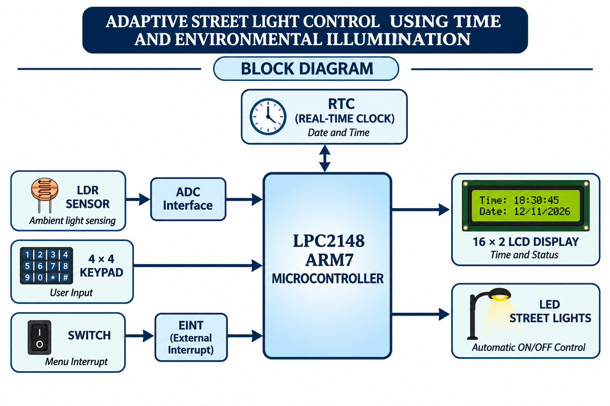
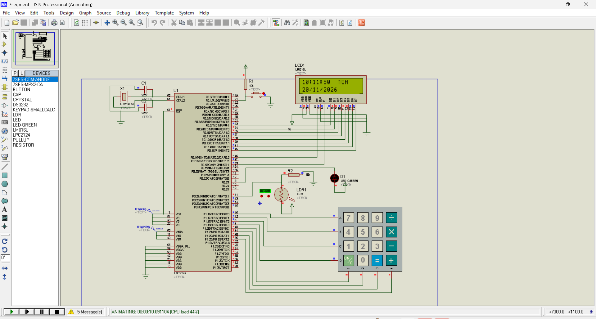
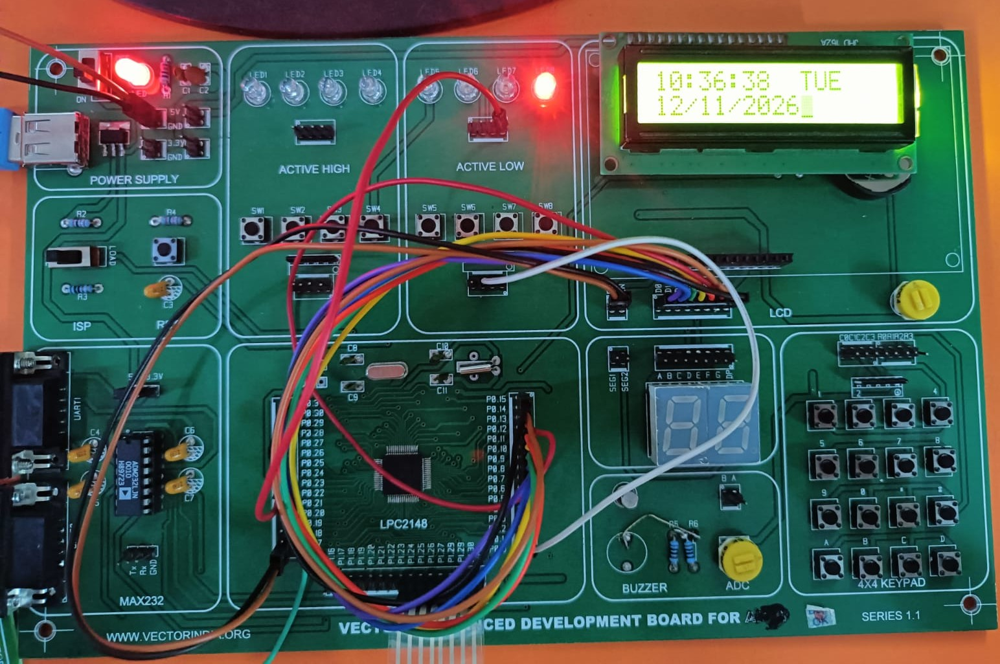
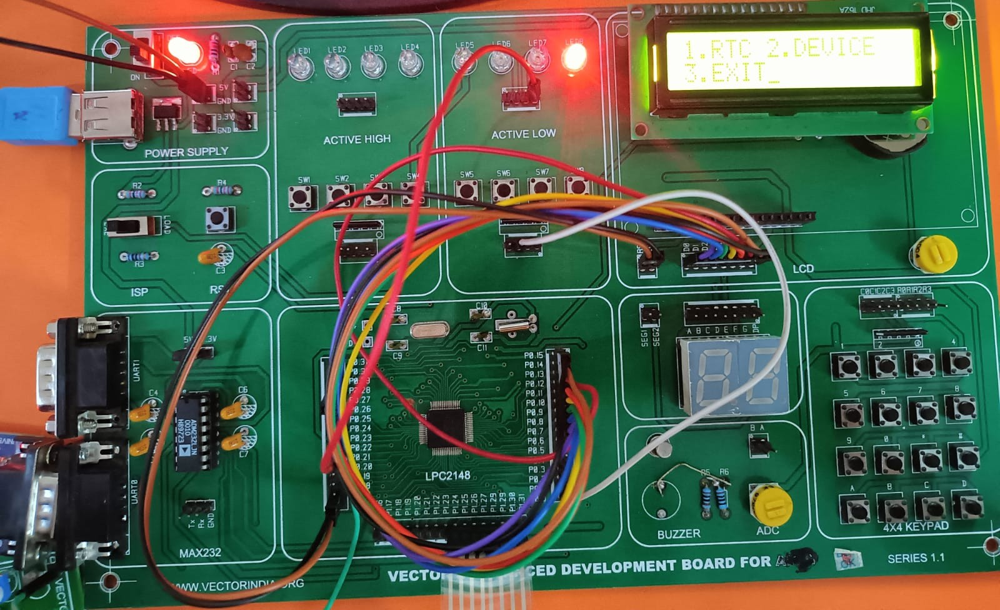
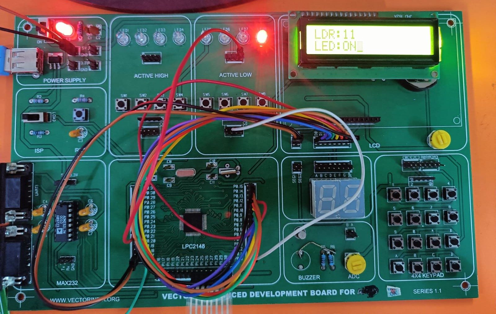
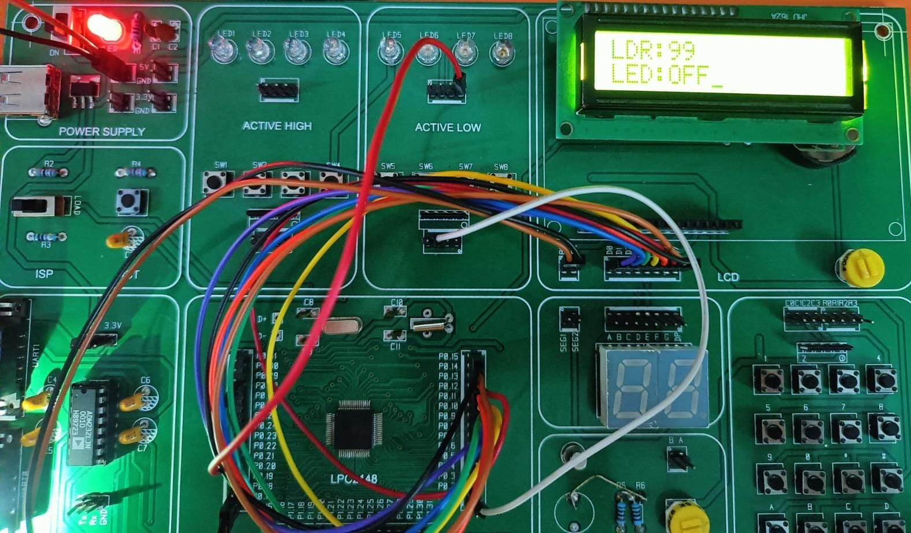

**Adaptive Street Light Control System Using Time and Environmental Illumination**

**1.Project Overview**

The Adaptive Street Light Control System is an embedded systems project developed using the LPC2148 ARM7 microcontroller.The system automatically controls street light operation based on predefined time settings and surrounding environmental light intensity.An LDR sensor is used to detect ambient light intensity through the ADC. The RTC maintains date and time information. The microcontroller processes these inputs and controls the street light accordingly.A 16x2 LCD displays the system information, while a 4x4 keypad allows the user to navigate the menu and configure RTC settings.

**2.Objectives**

- Automate street light operation.
- Reduce unnecessary power consumption.
- Monitor environmental light intensity using an LDR sensor.
- Maintain date and time using RTC.
- Provide user interaction through a keypad.
- Display system information on an LCD.

**3.Hardware Requirements**

- LPC2148 ARM7 Microcontroller
- LDR Sensor Module
- 16x2 LCD Display
- 4x4 Matrix Keypad
- LED Street Light Indicator
- RTC
- External Interrupt
- Connecting Wires
- Power Supply

 **4.Software Requirement**

- Embedded C
- Keil µVision IDE
- Proteus Design Suite
- ARM7 Microcontroller

**5.Working Principle**

1. The RTC provides the current date and time.
2. The LDR sensor detects surrounding light intensity.
3. The ADC converts the analog sensor output into a digital value.
4. An External Interrupt is occured to set the device timings and to edit the RTC timings.
5. The microcontroller processes the sensor readings and time information.
6. Based on the programmed conditions, the street light is switched ON or OFF.
7. The LCD displays the current time, date, LDR readings, and street light status.
8. The keypad allows the user to navigate the menu and edit RTC and device settings.

**6.Features**

- Automatic street light control.
- LDR-based environmental light monitoring.
- RTC-based time management.
- ADC interfacing.
- 16x2 LCD interfacing.
- 4x4 keypad-based menu navigation.
- RTC date and time configuration.
- External interrupt-based control.

**7.Project Modules**

| File | Description |
|---|---|
| main.c | Main application |
| adc.c / adc.h | ADC configuration and reading |
| ldr.c / ldr.h | LDR sensor interfacing |
| lcd.c / lcd.h | LCD interfacing |
| kpm.c / kpm.h | Keypad interfacing |
| rtc.c / rtc.h | RTC operations |
| menu.c / menu.h | Menu handling |
| switching.c / switching.h | Street light switching |
| interrupt.c / interrupt.h | External interrupt handling |
| delay.c / delay.h | Delay functions |

**8.How to Run**

1. Clone or download this repository.
2. Open the project in Keil µVision.
3. Select the LPC2148 microcontroller.
4. Add the required source and header files.
5. Build the project.
6. Generate the HEX file.
7. Load the HEX file into the hardware or Proteus simulation.
8. Run the project and observe the LCD output.

**9. Project Diagrams and Hardware Outputs**

1. System Block Diagram

 2. Proteus Simulation

 3. RTC Display

4. External Interrupt Output

 5. Streetlight ON Condition

 6. Streetlight OFF Condition

**10.Applications**

- Smart city street lighting.
- Highway lighting systems.
- Campus lighting automation.
- Parking area lighting.

**11.Future Enhancements**

- IoT-based remote monitoring.
- Wireless street light control.
- Energy consumption monitoring.
- Fault detection and reporting.

**12.Conclusion**

This project demonstrates the practical implementation of an embedded system using the LPC2148 ARM7 microcontroller. By integrating RTC, ADC, LDR, LCD, keypad, and external interrupt modules, the system provides an automated approach to street light management and helps reduce unnecessary energy consumption.

**Technologies Used:** Embedded C | ARM7 LPC2148 | Keil µVision | Proteus
